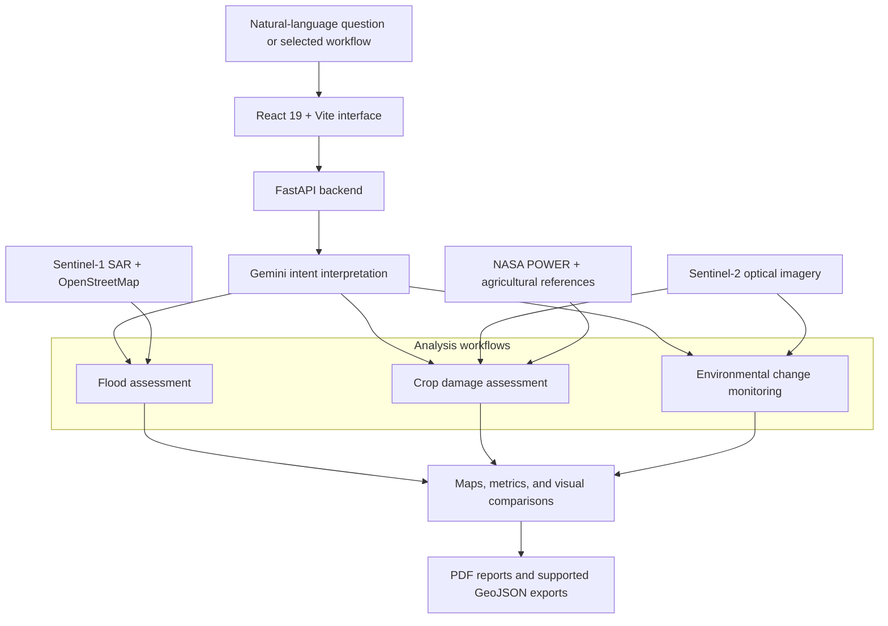

<div align="center">

# 🛰️ SatQuery

### Satellite intelligence for communities across India

Turn satellite imagery, weather data, and natural-language questions into insights for **disaster response**, **agricultural welfare**, and **environmental accountability**.


**Ask a question. Explore the evidence. Inform local action.**

[**🚀 Launch Live Demo**](https://satquery-jade.vercel.app/) · [**Backend Service**](https://sat-query-tm18.onrender.com)

[Overview](#overview) · [Use Cases](#use-cases) · [How It Works](#how-it-works) · [Quick Start](#quick-start) · [Validation](#validation) · [Responsible Use](#responsible-use)

</div>

---

## Overview

SatQuery v2.0 brings remote sensing into everyday civic workflows. It combines Sentinel-1 radar, Sentinel-2 optical imagery, NASA POWER weather data, OpenStreetMap infrastructure, and agricultural reference data with Google Gemini to help people investigate changes on the ground.

**The problem:** Satellite observations, weather archives, and local infrastructure records are spread across separate systems. Turning those sources into a useful local investigation can require specialist tools and manual interpretation.

**The approach:** SatQuery organizes those sources into three focused workflows, with a natural-language interface and exportable findings. It is designed for relief planners, agricultural support teams, civic groups, and investigative journalists.

> **Documentation scope:** This README describes the intended v2.0 workflows. The documentation-only package does not include application source, test results, or sample outputs; implementation status and runtime behavior must be verified against the full project. The architecture below is a conceptual overview.

The platform is designed around three questions:

| Focus | Question | Intended output |
| :--- | :--- | :--- |
| 🚨 **Disaster response** | Which areas and infrastructure may be affected by flooding? | Flood maps, infrastructure risk indicators, and candidate bypass waypoints |
| 🌾 **Agricultural welfare** | What do vegetation and weather records suggest about crop damage? | Before-and-after vegetation analysis and supporting loss reports |
| 🌳 **Environmental accountability** | Where are water bodies, forests, or riverbeds changing? | Change estimates, mapped evidence, and draft civic documents |

## Use Cases

### What makes SatQuery distinctive

| Design choice | Practical value |
| :--- | :--- |
| **Three public-interest workflows in one interface** | Connect disaster response, crop assessment, and environmental investigations through a shared analysis experience. |
| **Radar, optical, weather, and infrastructure context** | Give users multiple sources to inspect when interpreting a change. |
| **English and Hindi natural-language requests** | Lower the interaction barrier for users unfamiliar with GIS terminology. |
| **India-focused civic context** | Connect observations to agricultural support, RTI drafting, and environmental complaint preparation. |
| **Visual results and portable outputs** | Help users move from an on-screen investigation to a report or geospatial file that others can review. |

These are the project's design strengths; comparative performance and real-world impact remain to be demonstrated through validation.

### 🚨 Flood assessment & infrastructure triage

Support flood investigations during monsoon conditions, when cloud cover can limit optical imagery.

- **Radar-based flood detection:** Compare pre- and post-event Sentinel-1 VV backscatter to identify potential inundation and waterlogging.
- **Infrastructure overlays:** Cross-reference OpenStreetMap roads, highways, and bridges with detected flood areas.
- **Risk screening:** Highlight infrastructure that may intersect affected areas for further assessment.
- **Planning exports:** Generate candidate bypass waypoints and GeoJSON coordinates for operational review.

### 🌾 Crop damage assessment

Bring vegetation changes, weather records, and local agricultural benchmarks into a single investigation.

- **Vegetation monitoring:** Compare Sentinel-2 Normalized Difference Vegetation Index (NDVI) across a suspected damage event.
- **Weather context:** Use NASA POWER precipitation and temperature records to investigate possible weather-related stress.
- **Agricultural benchmarks:** Retrieve district yield and seasonal reference information from sources such as DACNET, DES, and ICAR, where available.
- **Supporting reports:** Generate PDF summaries for documentation and review in crop-loss and PMFBY-related workflows.

### 🌳 Environmental change monitoring

Help civic groups and journalists investigate potential sand mining, forest encroachment, and shrinking water bodies.

- **Change detection:** Compare satellite observations across dates to locate visible changes.
- **Area estimates:** Quantify detected changes in hectares, subject to imagery resolution and analysis quality.
- **Mapped evidence:** Identify areas of interest using georeferenced bounding boxes and coordinates.
- **Draft documents:** Prepare RTI application and environmental complaint drafts for human review.

## Ask in Natural Language

The AI mode is designed to accept questions in **English or Hindi**, identify the relevant workflow, and translate place names into an area of interest.

Example requests:

```text
Compare Sukhna Lake's water extent between March 2023 and March 2024.
```

```text
Assess flood exposure for roads around Majuli, Assam, comparing May and July 2024.
```

```text
Check vegetation changes and rainfall near Ludhiana between June and September 2024.
```

```text
पानीपत के पास यमुना नदी के किनारे हुए बदलाव दिखाओ।
```

For a more useful analysis, include a **specific location**, **date range**, and **type of change**. Results depend on available observations and the accuracy of the selected area.

These are example requests, not recorded results. A place name identifies a search area; farm-level analysis also requires a verified field location or boundary.

### Inputs & outputs

| Workflow | Information needed | Results to inspect |
| :--- | :--- | :--- |
| Flood assessment | Area of interest and pre-/post-event dates | Radar comparison, potential flood extent, infrastructure intersections, and available GeoJSON exports |
| Crop assessment | Field or area boundary, crop context, and comparison dates | NDVI change, weather context, available agricultural benchmarks, and a supporting PDF report |
| Environmental monitoring | Feature or area boundary, change type, and comparison dates | Before-and-after imagery, estimated changed area, mapped locations, and draft documents |

Inspect the selected location and actual observation dates before interpreting any result. Missing imagery or unavailable reference data should be treated as an incomplete analysis rather than evidence of no change.

## How It Works

1. **Describe the question** — Enter a place, time period, and investigation goal.
2. **Select the workflow** — Gemini interprets the request and routes it to flood, crop, or environmental analysis.
3. **Gather observations** — Retrieve relevant satellite, weather, infrastructure, and reference data.
4. **Compare and interpret** — Examine changes and summarize supporting indicators.
5. **Review and export** — Inspect visual comparisons and download available reports or geospatial outputs.



### Technology & data

| Layer | Technology / source | Role |
| :--- | :--- | :--- |
| Interface | React 19, Vite | Interactive workflows and results |
| Backend | Python, FastAPI | API endpoints and analysis services |
| AI | Google Gemini | Intent interpretation and multimodal analysis |
| Radar imagery | Sentinel-1 SAR | Flood-related backscatter comparisons |
| Optical imagery | Sentinel-2 L2A | Vegetation and surface-change analysis |
| Weather | NASA POWER | Precipitation and temperature context |
| Infrastructure | OpenStreetMap / Overpass API | Roads, bridges, and other mapped features |
| Agricultural references | DACNET, DES, ICAR | District and seasonal benchmarks, where available |
| Reports | jsPDF | Downloadable PDF documents |

## Quick Start

These steps assume the full project contains `backend/` and `frontend/` directories. Run commands from the repository root unless indicated otherwise.

### Prerequisites

- Python with `pip` and `venv` support
- Node.js and npm
- Access to the external services used by your configured workflows
- Required provider credentials and environment variables configured according to the project setup documentation

Use the Python and Node.js versions supported by the full project's dependency manifests. Exact supported versions and environment variable names are not specified in this documentation package.

### Configuration requirements

| Component | Configuration to confirm before running |
| :--- | :--- |
| Gemini integration | Provider credentials and the model selected by the backend |
| Satellite access | The imagery provider, access method, and any required credentials |
| Weather and reference data | Network access and availability of the configured data sources |
| Frontend-to-backend connection | The frontend API base URL and backend CORS settings for the development origin |

Use the full project's environment template or configuration module for exact setting names and file locations. Keep private credentials on the backend and out of Git history; browser-delivered configuration is visible to users.

### 1. Start the backend

Create a virtual environment:

```bash
cd backend
python -m venv .venv
```

Activate it using the command for your shell:

| Shell | Command |
| :--- | :--- |
| Windows PowerShell | `.\.venv\Scripts\Activate.ps1` |
| Windows Command Prompt | `.venv\Scripts\activate.bat` |
| macOS / Linux | `source .venv/bin/activate` |

Install dependencies and start the API:

```bash
python -m pip install -r requirements.txt
python -m uvicorn app.main:app --host 127.0.0.1 --port 8000 --reload
```

The backend runs at **http://127.0.0.1:8000**.

### 2. Start the frontend

Open a second terminal at the repository root:

```bash
cd frontend
npm install
npm run dev
```

Open **http://localhost:5173**, or the URL printed by Vite, to explore SatQuery.

### Deployment & configuration

| Service | Hosting | Live URL |
| :--- | :--- | :--- |
| Frontend | Vercel | [Launch SatQuery](https://satquery-jade.vercel.app/) |
| Backend | Render | [Backend service](https://sat-query-tm18.onrender.com) |

Open the frontend to use the application. The backend URL is the service base address; available API routes depend on the deployed application.

The project references a deployment guide at `docs/CLOUD_DEPLOYMENT_SETUP.md` for Vercel, Render, provider API keys, and Telegram bot status. Consult that guide if it is included in your checkout.

### Troubleshooting

| Symptom | What to check |
| :--- | :--- |
| `backend/` or `frontend/` is missing | Obtain the full application repository; the README alone cannot run the platform. |
| Python cannot import a dependency | Confirm the virtual environment is active and install the backend requirements with that environment's Python. |
| Frontend loads but requests fail | Check that the backend is running, the API base URL matches its address, and the frontend origin is allowed by CORS. |
| Provider authentication fails | Confirm the credentials and service access required by the backend configuration. |
| No imagery or benchmarks are returned | Check the selected area, date coverage, provider availability, and backend error details. |
| Development port is already in use | Use the address printed by the development server and update the API configuration if the backend port changes. |

## Validation

### Suggested demonstration

Use one well-defined environmental investigation to show the complete workflow, then demonstrate the flood and crop modes with their own suitable observations.

| Step | What to show | What it demonstrates |
| :--- | :--- | :--- |
| 1. Frame the question | A specific place, comparison period, and investigation goal | A concrete user problem |
| 2. Confirm the area | The resolved location and selected boundary | Spatial relevance |
| 3. Inspect observations | Actual source dates and before-and-after views | Traceability |
| 4. Explain the result | Metrics, units, and interpretation limits | Analytical clarity |
| 5. Export findings | An available report or geospatial download | A usable deliverable |
| 6. Show a limitation | A request with unavailable observations | Honest handling of incomplete evidence |

Use actual application captures and outputs for a public demo. Keep illustrative examples visibly separate from measured results.

### Impact to measure

| Intended benefit | Suggested measurement |
| :--- | :--- |
| Faster investigation | Median time from a valid request to a reviewable result, including data retrieval |
| More accessible analysis | Task completion rate for first-time users in English and Hindi |
| Reliable spatial findings | Agreement with independent reference observations, reported by workflow |
| Reviewable evidence | Fraction of exports with source identifiers, observation dates, boundaries, and units |
| Practical field value | Feedback from relief, agricultural, and civic users on completed investigations |

Report the sample size, evaluation conditions, and failure cases alongside any published measurements. No impact or performance numbers are claimed here.

### Verification checklist

The following checklist defines practical review steps; it is **not a record of passing tests**. No automated test command, accuracy benchmark, or measured latency is supplied in this documentation package.

### Local smoke test

1. Start the backend and frontend using the setup instructions; check both terminal logs for startup errors.
2. Open the frontend and submit a request with a specific location and comparison dates.
3. Confirm that the selected area and workflow match the request.
4. Check that the results identify the data sources and observation dates used, or record their absence as a validation gap.
5. Inspect the visual comparison and reported metrics for consistency with the selected area and period.
6. Exercise each available export; verify that the downloaded file opens and agrees with the displayed result.
7. Repeat with an ambiguous location, unavailable date coverage, and a provider failure. Check that the application reports the limitation without presenting invented results.

### Workflow acceptance criteria

| Workflow | Evidence needed for a successful review |
| :--- | :--- |
| Flood assessment | Traceable pre-/post-event radar observations, inspectable flood boundaries, infrastructure intersections, and clearly labeled candidate routes |
| Crop assessment | Traceable vegetation observations, corresponding weather records, benchmark provenance where used, and consistent report contents |
| Environmental monitoring | Comparable observations, a documented change-detection method, area units and resolution assumptions, and inspectable mapped changes |
| Natural-language interface | Representative English and Hindi requests routed to the appropriate workflow, with ambiguous locations resolved before analysis |

For reproducible evaluation, record the code revision, runtime versions, request, selected boundary, source observation identifiers, configuration excluding secrets, and downloaded outputs. Numerical accuracy requires comparison against independent reference data; a successful UI demonstration alone does not establish accuracy.

## 📜 Regulatory & Legal Grounding

The original project statements are preserved below. **These are claims requiring implementation and legal validation, not established findings of compliance.** Read them together with the qualification immediately following the list.

- **Section 65B, Indian Evidence Act, 1872:** Telemetry streams and SHA-256 addressed digital visual exhibits meet statutory admissibility criteria for electronic records.
- **PMFBY Operational Guidelines:** Statutory 33% localized calamity threshold verified objectively against Sentinel-2 NDVI canopy decline.
- **RTI Act 2005 (Section 6) & NGT Act 2010 (Sections 14 & 15):** Structured petitions automatically populate jurisdiction, grounds, and specific prayer clauses.

**Current legal and technical qualification:** Electronic-record evidence must be assessed under the applicable law, including Section 63 of the Bharatiya Sakshya Adhiniyam, 2023 where applicable; hashing alone does not demonstrate satisfaction of its conditions and certification requirements. See the [official statutory text](https://www.indiacode.nic.in/bitstream/123456789/20063/1/a2023-47.pdf).

The stated 33% threshold and its proposed verification through NDVI have not been substantiated by the material supplied with this project. Do not use that statement as an insurance eligibility rule or equate NDVI decline with an assessed percentage of crop loss. The government's [explanation of satellite-based crop-loss assessment](https://www.pib.gov.in/Pressreleaseshare.aspx?PRID=2101838&lang=2&reg=48) describes localized-risk losses as assessed on an individual insured-farm basis. Applicable scheme terms and assessment procedures require separate verification.

Automatic drafting also requires verification against the implementation. Review jurisdiction, factual allegations, statutory references, and requested relief before using any generated application or complaint.

## Responsible Use

SatQuery provides analytical support. Its outputs require interpretation in the context of observation dates, spatial resolution, data coverage, and local conditions.

- **Flood response:** Satellite-derived flood boundaries and candidate routes require field validation before operational use. They do not establish that a road or route is safe.
- **Crop-loss assessment:** Vegetation changes and weather anomalies are supporting indicators. They do not independently determine the cause of damage, insurance eligibility, or claim approval.
- **Environmental investigations:** Detected changes can identify areas for investigation; they do not independently establish unlawful activity or exact property boundaries.
- **Documents and evidence:** Generated reports, RTI applications, and complaint drafts require review. A generated report should not be presented as an official certificate or assumed to be legally admissible.

## Development Priorities

The following are proposed improvements, not released features or delivery commitments:

- [ ] Publish reproducible sample investigations with observation identifiers and downloadable outputs.
- [ ] Document exact runtime versions, environment settings, API contracts, and test commands from the application source.
- [ ] Validate each analysis workflow against independent reference data and publish the methodology.
- [ ] Add regression coverage for missing imagery, ambiguous locations, provider failures, and export consistency.
- [ ] Review English/Hindi usability and accessibility with representative users.
- [ ] Validate legal templates and PMFBY-related wording with qualified domain reviewers.
- [ ] Publish a deployment checklist covering credentials, source availability, and service costs.

## Contributing

Useful contributions include reproducible bug reports, improvements to data-source handling, analysis validation, accessibility, and clearer documentation.

When reporting an issue, include the workflow, location and date range, steps to reproduce, and expected versus actual results. Remove API keys, personal information, and sensitive location details from shared logs and screenshots.

For code contributions, describe the behavior being changed, include appropriate validation results, and update documentation when setup or outputs change.

## License

No license file is included in this documentation package. Check the full repository for its license and review the applicable terms for third-party data and services before reuse or redistribution.

---

<div align="center">

**SatQuery · From satellite observations to informed local action.**

</div>
