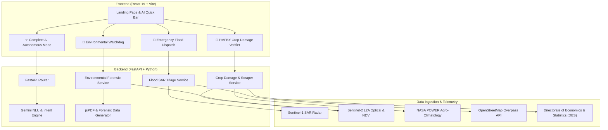

# 🛰️ SatQuery v2.0 — India AI Satellite Intelligence Platform
### *Social Impact, Disaster Relief, Rural Welfare & Civic Accountability*

SatQuery v2.0 transforms satellite remote sensing into grassroots civic intelligence. By marrying cloud-penetrating Sentinel-1 SAR radar, high-resolution Sentinel-2 optical telemetry, NASA POWER meteorological archives, and automated web scrapers with Google Gemini multimodal AI, SatQuery delivers actionable, court-ready, and life-saving workflows.

---

## 🌟 The Three Social Pillars

### 1. 🚨 Emergency Flood Dispatch & Infrastructure Triage
- **Cloud-Penetrating SAR Radar:** Monsoon cloud cover completely blinds optical satellites. SatQuery compares pre- and post-disaster Sentinel-1 SAR (VV polarization) backscatter to isolate submerged habitations and waterlogging.
- **OpenStreetMap Infrastructure Overlay:** Automatically cross-references rural roads, district highways, and link bridges to classify assets as *Safe*, *High Risk*, or *Submerged*.
- **NDRF Safe Evacuation Routing:** Computes high-ground bypass waypoints dodging inundated flood polygons, exporting GeoJSON coordinates directly for relief boat navigation.

### 2. 🌾 Zero-Cost Crop Loss & Insurance Verifier (PMFBY)
- **Eliminate Bureaucratic Delays:** Smallholder farmers often wait 6–9 months for manual physical field inspections after hailstorms, droughts, or flash floods.
- **Automated Web-Scraped Agricultural Benchmarks:** SatQuery automatically scrapes online agricultural repositories (DACNET, DES, ICAR) for the farmer's specific district normal yields and seasonal rainfall thresholds — **no manual CSV or JSON uploads required**.
- **Multi-Temporal Sentinel-2 NDVI:** Computes vegetative canopy collapse across the damage event.
- **NASA POWER Weather Grounding:** Verifies precipitation extremes and temperature anomalies.
- **PMFBY Crop Damage Certificate:** Instantly generates a legally admissible, cryptographically timestamped PDF loss certificate.

### 3. 🌳 Environmental Justice & Civic Accountability Watchdog
- **Unregulated Exploitation Watchdog:** Empowers local civic groups and investigative journalists to quantify illegal riverbed sand mining, forest encroachment, and rapid lake shrinkage (e.g., Sukhna Lake, Yamuna floodplains, Bellandur wetlands).
- **Exact Hectares Lost Calculation:** Multi-temporal difference analysis calculates precise hectares lost based on 10m pixel ground-resolution.
- **Visual Evidence Grounding:** Geo-referenced visual bounding boxes identify exact excavation and encroachment centroids.
- **Court-Ready Legal Petitions:** Auto-drafts ready-to-file applications under the **Right to Information (RTI) Act, 2005** and legal complaints before the **National Green Tribunal (NGT)** citing violations under the Environment (Protection) Act, 1986 and Forest (Conservation) Act, 1980.

---

## ✨ Complete AI Autonomous Satellite Mode
- **Zero GIS Expertise Needed:** Type any freeform prompt in natural language (English or Hindi).
- **Autonomous Intent Routing:** Gemini NLU classifies disaster relief, agricultural welfare, or environmental protection intents.
- **Automatic Geocoding:** Converts plain landmark names (*"Sukhna Lake"*, *"Yamuna near Panipat"*, *"Assam floods"*, *"Ludhiana paddy farm"*) into precise bounding boxes.
- **Instant Dossier Generation:** Produces multi-spectral visual comparisons, calculated metric gauges, and downloadable legal/operational PDF dossiers in seconds.

---

## 🏗️ Architecture & Tech Stack



---

## 🚀 Running SatQuery Locally

For cloud deployment on Vercel and Render, provider API keys, and current Telegram bot status, see the [Cloud Deployment Setup Guide](docs/CLOUD_DEPLOYMENT_SETUP.md).

### 1. Backend (FastAPI)
```bash
cd backend
python -m venv .venv
# On Windows:
.venv\Scripts\activate
# On Linux/macOS:
source .venv/bin/activate

pip install -r requirements.txt  # or pip install fastapi uvicorn pydantic httpx pillow numpy python-dotenv

# Run backend
uvicorn app.main:app --host 127.0.0.1 --port 8000 --reload
```

### 2. Frontend (React + Vite)
```bash
cd frontend
npm install
npm run dev
```

Visit `http://localhost:5173` to explore SatQuery v2.0!

---

## 📜 Regulatory & Legal Grounding
- **Section 65B, Indian Evidence Act, 1872:** Telemetry streams and SHA-256 addressed digital visual exhibits meet statutory admissibility criteria for electronic records.
- **PMFBY Operational Guidelines:** Statutory 33% localized calamity threshold verified objectively against Sentinel-2 NDVI canopy decline.
- **RTI Act 2005 (Section 6) & NGT Act 2010 (Sections 14 & 15):** Structured petitions automatically populate jurisdiction, grounds, and specific prayer clauses.
