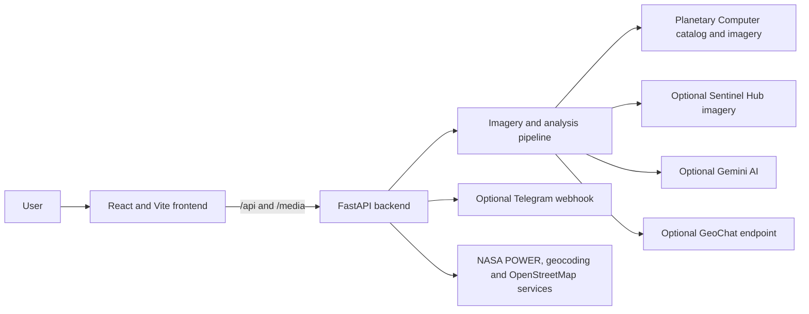

# SatQuery

**SatQuery is an open-source satellite-imagery analysis prototype that helps people explore Earth-observation data through a web interface and natural-language questions.** Users can search for a place, choose an observation date or date range, submit an analysis, and inspect the returned imagery, model response, metadata, and warnings. The project is designed to make satellite analysis more approachable for students, civic groups, researchers, and hackathon teams—not to replace trained analysts or official assessments.

The application combines a React web client with a Python API. Depending on the workflow and configured providers, the backend can retrieve satellite observations, prepare image products, perform date-paired analysis, and call an AI model to describe imagery. A separate set of social-impact workspaces demonstrates possible applications in flood response, crop-damage screening, and environmental monitoring.

## What SatQuery does

- **Ask questions about a location:** Search for a place or enter coordinates, select a date, and ask an Earth-observation question in English or Hindi.
- **Inspect satellite evidence:** View returned scenes, acquisition dates, sensor and source metadata, geographic bounds, pixel usability, and warnings alongside the generated answer.
- **Compare observations:** Request before-and-after imagery and inspect the comparison. Where supported, the backend also reports screening metrics and a GeoJSON change layer.
- **Explore optical and radar imagery:** The core pipeline supports Sentinel-2 optical and Sentinel-1 radar observations through satellite catalog and imagery services. These sensors have different characteristics; a visual difference is not automatically proof of a real-world event.
- **Try social-impact workflows:** The interface includes flood-response, crop-damage, and environmental-monitoring workspaces. These are experimental demonstrations, not validated emergency, insurance, or legal decision systems.
- **Connect optional services:** Gemini can provide AI analysis; an optional GeoChat-compatible endpoint can analyze a single image. The Telegram bot supports crop-claim intake and returns an informational report when its deployment credentials are configured.

## Project status and responsible use

SatQuery is a prototype. The core satellite-query pipeline includes evidence and acquisition metadata, but provider coverage, image quality, model output, and analysis accuracy depend on the selected location, dates, upstream services, and configuration. Missing data or a successful API response should not be interpreted as confirmation that a model assessment is correct.

The social-impact flood, crop-damage, and environmental workspaces are not equivalent to validated geospatial measurements. Some paths can return synthetic/demo imagery and illustrative values when live inputs are unavailable or demo mode is enabled. Confirm the source and mode of every result before sharing it. Do not use prototype outputs to direct rescue operations, determine insurance eligibility, establish wrongdoing, or make legal claims. Telegram reports are informational and are not official insurance decisions; generated petition text is not legal advice.

The pilot API does not provide user accounts or project-level access control. Do not submit confidential or sensitive personal information. Review the [deployment notes](docs/DEPLOYMENT.md) and [cloud setup guide](docs/CLOUD_DEPLOYMENT_SETUP.md) before exposing an instance publicly.

## Social-impact use cases

These workspaces frame potential applications of satellite information; they do not imply that every listed measurement or operational outcome has been independently validated.

### Flood response and infrastructure triage

The flood workspace explores comparing observations around an event, viewing potential inundation areas, displaying nearby OpenStreetMap roads, and inspecting route-related information. Sentinel-1 radar can collect imagery through many cloud conditions, but interpreting radar changes requires care: acquisition geometry, land cover, and processing can affect backscatter. Verify all apparent flood areas and routes with current ground information before acting.

### Crop-damage screening and Telegram intake

The crop workflow explores combining vegetation imagery, weather context, and farmer-provided information. A Telegram bot can collect a location pin and claim details, ask for missing information, and return a screening report. Results are not a PMFBY claim determination, an official certificate, or a substitute for insurer procedures and field inspection.

### Environmental change exploration

The environmental workspace demonstrates ways to review possible changes involving vegetation, mining, and water bodies and to prepare draft civic-petition text. The current prototype's outputs may be synthetic or illustrative; they are not proof of illegal activity or a substitute for independently verified measurements, evidence collection, or legal review.

## Architecture



In the recommended hosted setup, Vercel serves the frontend and proxies `/api/*` and `/media/*` to the Render backend. The GeoChat-compatible service is optional and may be hosted separately; a Kaggle notebook must expose a reachable HTTPS inference endpoint to be used this way. Telegram also requires a configured bot token and webhook secret. See the [cloud deployment guide](docs/CLOUD_DEPLOYMENT_SETUP.md) for provider configuration and setup steps.

### Technology

- **Frontend:** React, Vite, Leaflet, Cesium, and Vitest.
- **Backend:** Python 3.12+, FastAPI, Pydantic, Rasterio, NumPy, Pillow, PyProj, and ReportLab.
- **Imagery and geospatial services:** Microsoft Planetary Computer/STAC, optional Sentinel Hub, NASA POWER, and OpenStreetMap/Nominatim services.
- **AI integrations:** Optional Google Gemini and optional GeoChat-compatible HTTP inference endpoint.
- **Hosting configuration:** Vercel rewrites for the frontend; a Dockerized FastAPI service suitable for Render.

## Run locally

You need Python 3.12 or newer, Node.js, and npm. Run the backend and frontend in separate terminals from the repository root.

### 1. Start the backend

```powershell
cd backend
python -m venv .venv
.\.venv\Scripts\Activate.ps1
python -m pip install -e ".[test]"
uvicorn app.main:app --host 127.0.0.1 --port 8000 --reload
```

On macOS or Linux, activate the environment with:

```bash
source .venv/bin/activate
```

The backend API is available at `http://127.0.0.1:8000`; interactive API documentation is at `http://127.0.0.1:8000/docs`. Provider credentials are optional for starting the server, but some analyses require working upstream services or credentials. Configure them in your local environment or an untracked `backend/.env` file. Never commit secrets.

### 2. Start the frontend

In a second terminal:

```powershell
cd frontend
npm ci
npm run dev
```

Open the local Vite URL printed in the terminal (typically `http://localhost:5173`). In local development, the frontend defaults to the backend at `http://127.0.0.1:8000`.

## Configuration

| Variable | Where | Purpose |
|---|---|---|
| `GEMINI_API_KEY` | Backend | Enables Gemini-backed analysis and Telegram voice/detail processing. |
| `SENTINEL_HUB_CLIENT_ID`, `SENTINEL_HUB_CLIENT_SECRET` | Backend | Sentinel Hub access for workflows that use that provider. |
| `GEOCHAT_ENDPOINT_URL` | Backend | Optional public HTTPS GeoChat-compatible inference endpoint. |
| `GEOCHAT_API_KEY` | Backend and inference service | Optional shared credential for the GeoChat endpoint. Keep it private. |
| `TELEGRAM_BOT_TOKEN`, `TELEGRAM_WEBHOOK_SECRET` | Backend | Enables Telegram webhook integration. |
| `VITE_TELEGRAM_BOT_USERNAME` | Frontend | Optional public bot username (without `@`) used to link to Telegram. |
| `VITE_API_BASE_URL` | Frontend | Optional API base URL; leave empty for local defaults or the Vercel same-origin proxy setup. |
| `VITE_CESIUM_ION_TOKEN` | Frontend | Optional browser-visible token for Cesium terrain. Restrict its allowed origins and assets. |
| `SATQUERY_DATA_DIR` | Backend | Writable directory for local SQLite state and generated artifacts; use persistent storage in hosted deployments if data must survive restarts. |

This list covers the common configuration. See the [cloud deployment guide](docs/CLOUD_DEPLOYMENT_SETUP.md) for optional provider settings, Vercel and Render instructions, the GeoChat request contract, and Telegram webhook registration. Never put backend secrets in `VITE_*` variables; frontend variables are exposed to browsers.

## API overview

The FastAPI application exposes interactive documentation at `/docs`. Key endpoints include:

| Endpoint | Purpose |
|---|---|
| `GET /health` | Basic process health check. |
| `GET /api/geocode?q=...` | Search for a place. |
| `POST /api/jobs` | Submit a satellite query for asynchronous processing. |
| `GET /api/jobs/{id}` | Read job status and, when complete, its result. |
| `DELETE /api/jobs/{id}` | Request cancellation of an active job. |
| `POST /api/flood/analyze` | Run the experimental flood workspace. |
| `POST /api/crop-damage/analyze` | Run the experimental crop-damage workspace. |
| `POST /api/environment/analyze` | Run the experimental environmental workspace. |
| `POST /api/ai/analyze` | Run a natural-language analysis request. |
| `POST /api/telegram/webhook` | Receive Telegram bot updates when configured. |

The job API currently uses local SQLite and one backend worker. Job IDs should be treated as private links; do not rely on them as a substitute for authentication or access control.

## Tests and checks

Run the frontend checks from `frontend`:

```bash
npm test
npm run lint
npm run build
```

Run the backend tests from `backend`:

```bash
python -m pytest
```

## Deployment and documentation

- [Cloud deployment setup: Vercel, Render, GeoChat, and Telegram](docs/CLOUD_DEPLOYMENT_SETUP.md)
- [Deployment, API operations, and retention notes](docs/DEPLOYMENT.md)
- [Roadmap and known limitations](docs/ROADMAP.md)
- [Historical project report](PROJECT_REPORT.md) — background only; consult this README and the operational docs for current behavior and limitations.
